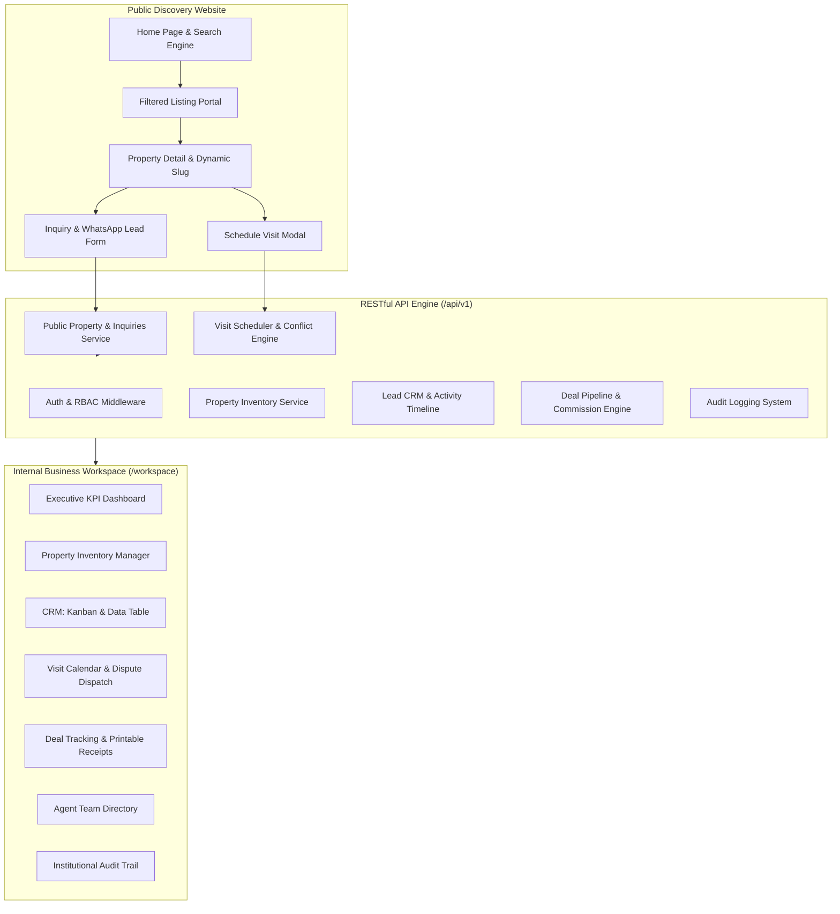

# AqarFlow Architecture & System Design
**Project 01 — VIRELEO Real Estate Operations & Property Discovery Platform**

---

## 1. System Overview

AqarFlow is engineered as a modern, high-performance web platform delivering both a public property listing portal and an internal ERP/CRM business workspace. It addresses the unique operational realities of Pakistan's real estate ecosystem:
- **Currency & Denominations**: Native support for Pakistani Rupees (PKR) formatted in Crore and Lakh.
- **Land Measurement Units**: Marla, Kanal, Square Feet, and Square Yards with automatic area conversions.
- **Urban Enclaves**: Specialized geographical categorization for Islamabad (Sectors F, G, E, Blue Area, Bahria, DHA), Lahore (DHA Phases 1-8, Gulberg, Model Town), Karachi (Clifton, DHA, Bahria Town Karachi), and Rawalpindi.
- **Operational Trust**: Verified broker attribution, double-booking visit protection, and transparent audit logging.



---

## 2. Component Architecture

### A. Dual Portal Structure
1. **Public Property Discovery Portal**:
   - `src/app/page.tsx`: Hero search bar, key statistics, featured properties, property categories, and value propositions.
   - `src/app/properties/page.tsx`: Advanced filterable listings with dynamic filters (purpose, property type, price ranges in PKR, bedrooms, sorting).
   - `src/app/properties/[slug]/page.tsx`: High-resolution gallery, unit dimensions, verified amenities, agent contact card, direct WhatsApp integration, and booking modal.
   - `src/app/about/page.tsx`, `src/app/services/page.tsx`, `src/app/contact/page.tsx`: Company story, operational pillars, advisory services, branch locations, and interactive FAQ accordion.

2. **Internal Business Workspace (ERP + CRM)**:
   - `src/app/workspace/page.tsx`: Real-time KPI cards (Active Listings, Open Leads, Scheduled Visits, Monthly Revenue, Deal Pipeline Value), lead funnel visualization, and recent activity streams.
   - `src/app/workspace/properties/page.tsx`: Inventory management with search, status filters (Draft, Available, Under Offer, Reserved, Sold, Rented), status toggling, and "Add Property" modal.
   - `src/app/workspace/leads/page.tsx`: Lead management with dual-view modes:
     - **Interactive Kanban Board**: Drag/click transitions across stages (*New, Contacted, Qualified, Visit Scheduled, Negotiation, Converted, Lost*).
     - **Data Table**: Tabular view with agent assignment, budget filtering, and quick actions.
     - **Lead Activity Drawer**: Chronological communication timeline (calls, WhatsApp messages, site meetings, internal notes) and follow-up reminders.
   - `src/app/workspace/visits/page.tsx`: Property visit scheduler equipped with **double-booking collision detection** (warns if an agent is already booked within a 45-minute window), outcome status logger (*Scheduled, Completed, Cancelled, No-Show*), and feedback notes.
   - `src/app/workspace/deals/page.tsx`: Sales transaction tracking with token deposit verification, legal milestone monitoring, automatic agency commission accrual (1% to 3%), and a **Printable Official Transaction Statement / Receipt**.
   - `src/app/workspace/agents/page.tsx`: Staff directory displaying performance metrics (active listings, assigned leads, closed deals).
   - `src/app/workspace/audit-logs/page.tsx`: Security and operations audit trail recording all entity modifications, actor IDs, IP addresses, and timestamps.

---

## 3. Security & Role-Based Access Control (RBAC)

The system implements strict permission controls across user tiers:

| Feature / Action | Public Visitor | Real Estate Agent | Agency Admin / Owner |
| :--- | :---: | :---: | :---: |
| Search & Browse Properties | ✅ | ✅ | ✅ |
| Submit Inquiry & Book Visit | ✅ | ✅ | ✅ |
| Access Workspace Dashboard | ❌ | ✅ (Scoped) | ✅ (Full) |
| Manage Own Assigned Leads | ❌ | ✅ | ✅ |
| Reassign Leads to Other Agents | ❌ | ❌ | ✅ |
| Create & Edit Property Inventory | ❌ | ✅ | ✅ |
| Archive / Delete Properties | ❌ | ❌ | ✅ |
| Schedule & Complete Visits | ❌ | ✅ | ✅ |
| Create Deals & View Commission | ❌ | ✅ (Own Deals) | ✅ (All Deals) |
| Add & Manage Team Members | ❌ | ❌ | ✅ |
| View System Audit Logs | ❌ | ❌ | ✅ |

### One-Click Role Switcher
For seamless demonstration during evaluation and pair-programming, AqarFlow includes an embedded demo role switcher in both the public navigation header and the workspace sidebar, permitting instant switching between:
- **Salman Tariq** (`admin@aqarflow.com`): Agency Principal Broker / Admin
- **Ayesha Khan** (`ayesha@aqarflow.com`): Senior Real Estate Agent

---

## 4. Double-Booking Conflict Engine

In real estate operations, scheduling overlapping client site visits with the same agent causes severe client dissatisfaction and operational friction. AqarFlow implements a deterministic conflict detection algorithm:

```typescript
// Conflict Detection Algorithm
const visitStart = new Date(data.scheduled_at).getTime();
const visitEnd = visitStart + 45 * 60 * 1000; // 45-minute inspection slot

const conflicting = existingVisits.find((ev) => {
  if (ev.agent_id !== data.agent_id) return false;
  if (ev.status === "cancelled") return false;

  const evStart = new Date(ev.scheduled_at).getTime();
  const evEnd = evStart + 45 * 60 * 1000;

  // Collision if slots overlap
  return (
    (visitStart >= evStart && visitStart < evEnd) ||
    (visitEnd > evStart && visitEnd <= evEnd) ||
    (visitStart <= evStart && visitEnd >= evEnd)
  );
});
```

When a conflict is detected:
1. The API and UI reject the schedule request.
2. An actionable error message displays: `"Agent [Name] already has a scheduled visit at [Time] with [Existing Client]."`.
3. The scheduler prompts the user to select an alternative time or assign a different agent.
